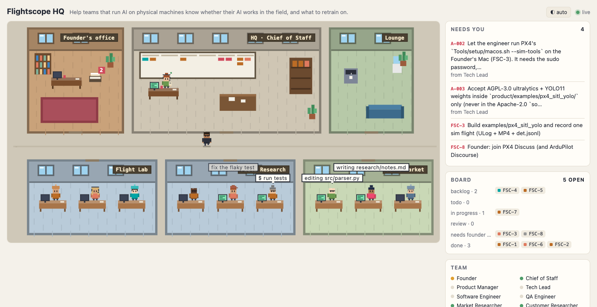

# company-factory

Build a **one-human, many-agent company** for Claude Code from a single config file.

You write `company.toml` (mission, roles, skills, approval gates, goals, workflows). The factory generates a workspace where:
- the main Claude Code session acts as the **Chief of Staff**: plans, delegates, reviews;
- each role is a subagent in `.claude/agents/` with a mission, owned paths, plugged-in skills, hard "never" rules and a definition of done;
- the **Founder** (you) approves anything external, irreversible, financial or directional through `company/approvals.md`;
- work is tracked on Taskboard (MCP) or a plain `company/board.md`.

Then open **the office**: a live pixel-art view of that company, where every role is a person at a desk, the Chief of Staff hands out work, subagents type, walk handoffs to the shelf, and your approvals pile up in the Founder's inbox. Rooms, people and looks come from the same `company.toml`.

Python 3.11+ standard library only. No npm, no build step, no cloud.

## Quick start
```bash
F=~/dev/company-factory/factory.py
python3 $F init ~/dev/mycompany                 # from examples/starter
#   edit ~/dev/mycompany/company.toml
python3 $F build ~/dev/mycompany --dry-run
python3 $F build ~/dev/mycompany
cd ~/dev/mycompany && claude                   # then: /setup-board (if Taskboard), /kickoff <goal>, /standup
python3 $F office ~/dev/mycompany --open       # in another terminal: the live office at http://127.0.0.1:4477
```

## The office


| You see | Comes from |
|---|---|
| Rooms and who sits where | `[[office.rooms]]` (default: one room per role `department`) |
| A person per role, with a stable look | `look = {...}` on a role (default: derived from the role id) |
| Chief of Staff throwing a ticket to a desk, the desk lighting up, a bubble with what they are doing | Claude Code hooks: `Agent` tool calls, `SubagentStart`, tool calls inside the subagent |
| Someone walking a handoff to the shelf | `SubagentStop`, plus `handoffs/*.md` on the shelf |
| Guests at the meeting table | built-in subagents (Explore, general-purpose, ...) that are not roles |
| The kanban wall and the Board panel | Taskboard REST API (`[taskboard] enabled`) or `company/board.md` |
| The Founder's inbox badge and *Needs you* | Pending items in `company/approvals.md` + tickets in `needs_founder` |
| A ring and a bell at the Founder's desk | `Notification` (Claude is waiting on a permission or on you) |

How it works: `build` adds `.claude/hooks/office_event.py` and registers it as an **async** hook in `.claude/settings.json`, so it never slows Claude down. It appends one short line per event to `.office/events.jsonl` (git-ignored): event, agent, tool and a few-word label such as a relative file path. Prompts, file contents and tool output are never written. `factory.py office` serves the page and tails that file.

Security: the server is read-only (no endpoint changes anything or runs anything), binds to `127.0.0.1` only, and rejects requests whose `Host` is not localhost, which blocks DNS-rebinding reads from other sites.

```toml
[office]
title = "Flightscope HQ"            # default: "<company> HQ"
theme = "auto"                     # auto (by local time) | day | night
port = 4477
taskboard_url = "http://127.0.0.1:3010"
founder_look = { shirt = "#2b2f3a", accessory = "glasses" }

[[office.rooms]]                   # any grouping you like; roles not placed go to "Open floor"
id = "flight-lab"
title = "Flight Lab"
roles = ["tech-lead", "engineer", "qa-engineer"]
floor = "#b9cbd9"

[[roles]]
use = "engineer"
look = { shirt = "#3d85c6", skin = "#d7a27a", hair = "#2b2118", hair_style = "spiky", accessory = "headset" }
# hair_style: short long bun spiky bald · accessory: none glasses headset cap beanie
```
Edits to `company.toml` show up in the open office within a few seconds; a bad edit shows a banner and keeps the last good office. Already have your own `.claude/settings.json`? `build` leaves it alone; merge in the output of `factory.py office-hooks`.

## How it fits together
```
library/                      shared, reusable building blocks
  defaults.toml               gates, autonomy, working rules, lanes, default workflows
  roles/<id>.toml             10 roles: product-manager, tech-lead, engineer, qa-engineer, designer,
                              market-researcher, customer-researcher, growth-marketer, sales-dev, finance-ops
  skills/<id>/SKILL.md        8 skills: spec-writing, code-change, code-review, competitor-research,
                              customer-interview, outreach-drafting, content-writing, metrics-report
  workflows/<id>.md           slash commands: standup, kickoff, approvals, weekly-review, setup-board, hire
  office/                     the office page and the Claude Code hook that feeds it
examples/<name>/              company.toml + custom/ + seed/ (seed files are copied into the company root by init)

<company>/
  company.toml                the source of truth
  custom/{roles,skills,workflows}/   your plug-ins; override library items with the same id
  -> generated: CLAUDE.md, company/{charter,org-chart,operating-rules}.md, handoffs/TEMPLATE.md,
                .claude/agents/*, .claude/skills/*, .claude/commands/*
  -> created once, then yours: company/{goals,decisions,approvals,board}.md, owned folders
```

## Configuring roles
```toml
[[roles]]
use = "engineer"                       # start from library/roles/engineer.toml
model = "opus"                         # override any field
owns = ["app/"]                        # replace a list...
skills_add = ["flight-log-analysis"]   # ...or extend it (skills_add, owns_add, responsibilities_add, never_add, done_add, tools_add)

[[roles]]
id = "support"                         # a role with no template: give title, description, mission, ...
title = "Support Engineer"
description = "Answers user issues and turns them into bug reports. Use for any inbound user question."
mission = "Every user question answered accurately within a day."
skills = ["content-writing"]
owns = ["support/"]
```
Policy: `[policy] extra_rules / extra_autonomy / extra_gates` extend the defaults; `rules` / `autonomy` / `[[gates]]` replace them.

## Plugging in a skill
Create `<company>/custom/skills/<name>/SKILL.md` with frontmatter `name` and `description`, add it to a role's `skills` or `skills_add`, and rebuild. Put a skill in `library/skills/` instead to share it across companies.

## Rebuild safety
- Generated files carry a header and are tracked in `.factory-manifest.json`; rebuilds overwrite only those, and delete them if a role/skill/workflow is removed.
- Existing files the factory did not create are never overwritten (use `--force` deliberately).
- Goals, decisions, approvals and the board are created once and never touched again.
- `validate` catches unknown roles/skills/workflows, bad ids, bad models and bad prefixes before anything is written.

## Commands
| Command | Does |
|---|---|
| `init <dir> [--example starter\|flightscope]` | copy an example's config, custom plug-ins and seed files (never overwrites) |
| `validate <dir>` | check the config |
| `build <dir> [--dry-run] [--force]` | generate / update the workspace |
| `list roles\|skills\|workflows [--dir <company>]` | show what can be plugged in (library + the company's custom) |
| `office <dir> [--port N] [--open]` | serve the live office for a company |
| `office-hooks` | print the hooks block the office needs, for merging into your own settings |

## Examples
- `starter`: generic 5-role product company, plain board file.
- `flightscope`: 9-role open-source drone-AI observability startup on Taskboard, with a custom `flight-log-analysis` skill and a configured office.

## Development
```bash
python3 -m unittest discover -s tests
```

## License
MIT. The office art is original and drawn in code; no third-party sprites.
