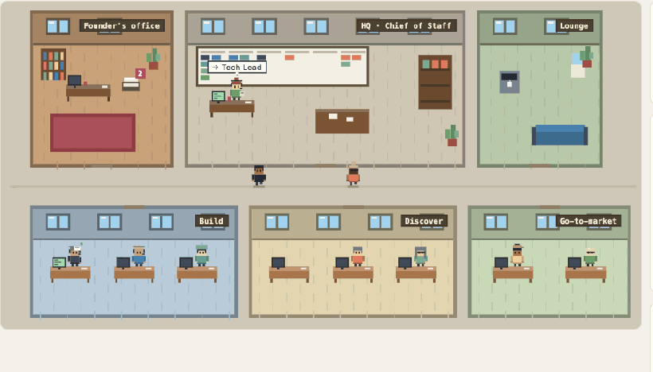

# company-factory

**Describe a company in one config file. Get a team of Claude Code agents that runs it, and a live pixel office where you watch them work.**



You are the founder. You write `company.toml`: the mission, the roles, their skills, what needs your approval, the goals. `company-factory` turns it into a Claude Code workspace where:

- the main session is your **Chief of Staff**: it plans, writes tickets, delegates and reviews;
- every role is a **subagent** with a mission, owned folders, preloaded skills, hard "never" rules and a definition of done;
- anything external, irreversible, financial or directional waits in **your approvals inbox**;
- the **office** shows all of it live: who is working on what, which ticket is where, what is waiting on you.

Python 3.11+ standard library, one HTML page, no build step, no cloud service. MIT.

## Try it in 30 seconds

```bash
uvx --from git+https://github.com/shouryaraj/company-factory company-factory demo
```
This builds a sample company in a temp folder and opens its office with scripted activity. No Claude session needed. Other demos: `--example open-source` or `--example content-studio`.

Without `uv`: `pipx run --spec git+https://github.com/shouryaraj/company-factory company-factory demo`.

## Start your own company

```bash
pipx install git+https://github.com/shouryaraj/company-factory   # or: uv tool install git+https://...

company-factory init ./acme --example saas    # or starter, open-source, content-studio
$EDITOR ./acme/company.toml                    # make it yours
company-factory build ./acme                   # generate the workspace (safe to re-run)
company-factory plugins ./acme --install       # one-time: install the marketplace skills

company-factory office ./acme --open           # terminal 1: the live office
cd acme && claude                              # terminal 2: /kickoff <goal>, /standup, /approvals
```

Prefer not to install? Clone the repo and use `python3 factory.py <command>` instead of `company-factory`.

## What you get

```
acme/
  company.toml                     the source of truth (you edit this)
  custom/{roles,skills,workflows}/ your own plug-ins; override built-ins with the same id
  CLAUDE.md                        generated: the Chief of Staff's operating manual
  .claude/agents/<role>.md         generated: one subagent per role, skills preloaded
  .claude/skills/<skill>/          generated: the skills your roles use
  .claude/commands/                generated: /standup /kickoff /approvals /weekly-review /hire ...
  .claude/settings.json            generated: office hooks + marketplace plugins
  company/charter.md, org-chart.md, operating-rules.md        generated
  company/goals.md, decisions.md, approvals.md, board.md      created once, then yours
  handoffs/                        one file per finished ticket
```

Rebuilds overwrite only files the factory generated (tracked in `.factory-manifest.json`). Your goals, decisions, approvals and board are never touched, and existing files that the factory did not create are skipped unless you pass `--force`.

## A company in config

```toml
[company]
name = "Paperplane"
mission = "Turn every support ticket into a product decision for small software teams."

[[roles]]
use = "engineer"                          # start from a built-in role...
model = "opus"                            # ...override any field
owns = ["app/"]
skills_add = ["security-review"]          # ...or extend a list
plugin_skills = ["example-skills:webapp-testing"]   # skills from a plugin marketplace
look = { shirt = "#3d85c6", hair_style = "spiky", accessory = "headset" }   # how they look in the office

[[roles]]
id = "triager"                            # or define a role from scratch
title = "Issue Triager"
description = "Reads new issues, reproduces bugs, drafts replies. Use for any incoming issue."
mission = "No issue waits more than a day for a useful first response."
skills = ["issue-triage"]

[[office.rooms]]
id = "build"
title = "Build"
roles = ["engineer", "triager"]
```

Everything is optional except a name, a mission and at least one role. Full reference: [docs/config.md](docs/config.md).

## Built in

**Roles (10):** product-manager, tech-lead, engineer, qa-engineer, designer, market-researcher, customer-researcher, growth-marketer, sales-dev, finance-ops.

**Skills (18)**, each a focused, opinionated procedure:

| Build | Discover | Grow | Run |
|---|---|---|---|
| code-change, code-review, debugging, test-plan, security-review, adr-writing, release-notes | spec-writing, customer-interview, competitor-research, pricing-research, ux-review | content-writing, launch-checklist, outreach-drafting, issue-triage | metrics-report, decision-memo |

**Marketplace skills, on by default:** Anthropic's [`document-skills`](https://github.com/anthropics/skills) (xlsx, docx, pptx, pdf) and `example-skills` (frontend-design, webapp-testing, doc-coauthoring, skill-creator, mcp-builder, ...). Add any Claude Code plugin marketplace with two lines of config. See [docs/skills.md](docs/skills.md).

**Workflows:** `/kickoff <goal>`, `/standup`, `/approvals`, `/weekly-review`, `/hire <role>`, `/setup-board`.

**Examples:** `company-factory list examples`

| Example | Shows |
|---|---|
| `starter` | a blank 5-role product company with placeholders |
| `saas` | an 8-role B2B SaaS startup with custom rooms and looks |
| `open-source` | maintainers of an OSS project: inline custom roles, a custom `/triage` workflow, custom gates |
| `content-studio` | a newsletter and video studio, to show a "company" does not have to write code |

## The office

`company-factory office <dir>` serves a live view at `http://127.0.0.1:4477`:

- **Rooms and people** come from `company.toml`. Each role has a stable look unless you set one.
- **Activity** streams from Claude Code hooks. When the Chief of Staff delegates, a ticket flies to a desk, the monitor lights up, and speech bubbles show the current step (`editing app/export.py`, `$ run tests`). When the work is done, the agent walks the handoff to the shelf. Built-in subagents such as Explore show up as guests.
- **The board** shows a kanban wall and lanes, read from `company/board.md` or from [Taskboard](docs/taskboard.md).
- **Needs you:** pending approvals pile up in the founder's inbox, and a bell rings when Claude is waiting on you.
- Day and night themes, and edits to `company.toml` show up without a restart.

Privacy and security: the hook records only the event, the agent, the tool and a few-word label. Prompts, file contents and tool output are never recorded. The server only reads: it cannot change files or run commands, it listens on localhost only, and it checks the `Host` header so other websites cannot read it. Details: [docs/office.md](docs/office.md).

## Taskboard (optional)

By default tickets live in `company/board.md`. For a real kanban board with an MCP server, use [Taskboard](https://github.com/tcarac/taskboard):

```bash
brew tap tcarac/taskboard && brew install taskboard
taskboard start                       # http://localhost:3010
```
```toml
[taskboard]
enabled = true
project = "Acme HQ"
prefix = "ACME"
```
`build` registers the Taskboard MCP server in the company's `.mcp.json`. In Claude Code, run `/setup-board` once: it creates the project, your lanes and one agent per role (it is idempotent). The Chief of Staff then creates and moves tickets through MCP, and the office reads the board live. See [docs/taskboard.md](docs/taskboard.md).

## Commands

| Command | Does |
|---|---|
| `demo [--example NAME]` | build a sample company in a temp folder and open its office with scripted activity |
| `init <dir> [--example NAME]` | copy an example's config and plug-ins (never overwrites) |
| `validate <dir>` | check the config and report every problem at once |
| `build <dir> [--dry-run] [--force]` | generate or update the workspace |
| `plugins <dir> [--install]` | print or run the commands that install the company's marketplace plugins |
| `office <dir> [--port N] [--open] [--demo]` | serve the live office |
| `list roles\|skills\|workflows\|examples [--dir <company>]` | show what can be plugged in |
| `office-hooks` | print the hooks block, for merging into your own `.claude/settings.json` |

## FAQ

**Does this run agents by itself?** No. Claude Code runs them, with your account and your permission settings. `company-factory` writes the workspace, and the office watches it.

**Will agents send emails or push code?** The operating rules make external communication, publishing, money, legal, irreversible actions and direction changes approval gates. Agents prepare that work and add a request to `company/approvals.md`. Your Claude Code permission settings still apply on top.

**Can I use my own roles and skills?** Yes. Put them in `<company>/custom/` (they can override a built-in with the same id), or add them to the library and send a PR.

**Windows?** The factory and office are pure Python and should work. The hook command uses `python3`. Reports welcome.

## Contributing

New roles, skills, examples and office art are all welcome. See [CONTRIBUTING.md](CONTRIBUTING.md). Run the tests with `python3 -m unittest discover -s tests`.

## License

MIT. The office art is original and drawn in code. The vendored [htm](https://github.com/developit/htm) + [Preact](https://preactjs.com) bundle keeps its own Apache-2.0 / MIT licenses (`src/company_factory/library/office/vendor/LICENSES.md`).
